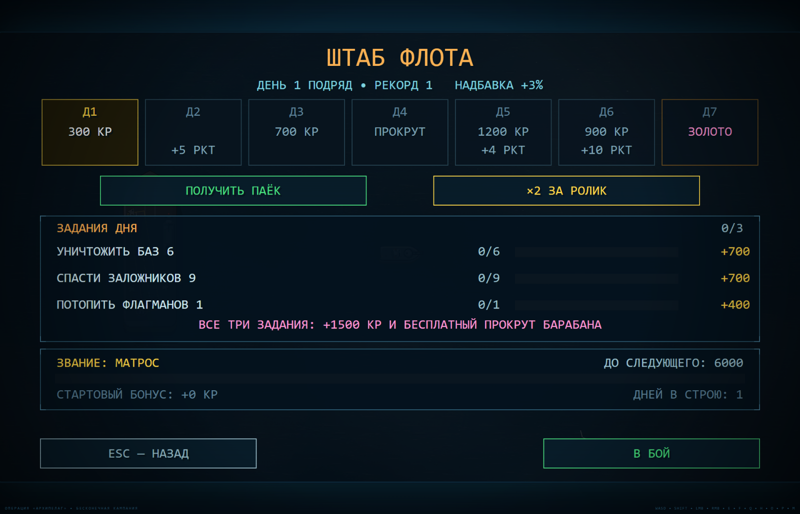

<div align="center">

# ⚓ OPERATION ARCHIPELAGO

### An endless naval campaign — one carrier, a whole hostile chain of islands

[](LICENSE)
[](#tech-stack)
[](#localization)
[](#platform-builds)

[**▶ Play now**](https://1ucomp.github.io/operation-archipelago/) · [Controls](#controls) · [Run locally](#run-locally) · [License](#license)

</div>



**Operation Archipelago** (original title *«Операция „Архипелаг“»*) is a
top-down naval arcade with an endless campaign. Your carrier **«СЕВЕР»** is
the only base you have: sail out, destroy enemy installations, rescue
hostages, sink flagships, then come back to the HQ for daily orders, a new
rank and a supply crate.


*Contact sheet from the trailer — level 1, «Периметр».*

> 🎥 **[Watch the trailer](trailer/archipelago_1920x1080.mp4)**
> (1920×1080 · also available in 1080×1920 and 1080×1620)

---

## About

Every sortie is a small tactics problem: the radar tells you what is out
there, the CIWS tells you what is about to hit you, and the fuel bar tells you
how long you can keep solving it.

Between sorties the game turns into a meta layer — daily objectives, a seven
day reward ladder, rank progression, a supply crate with a real timer, and a
shop for hull modules. Complete all three daily objectives for a bonus spin.

The whole thing runs on a `480×270` layout grid rendered at up to 1920×1080,
so the game logic, HUD and world coordinates are all written in one space while
the renderer picks its own pixel density.

## Features

- **Endless campaign** — procedurally sequenced levels with escalating
  difficulty rather than a fixed story length.
- **Real naval toolkit**: hull, boost, CIWS, radar, depth charges, smoke
  markers and a repair cycle.
- **Mission types** — assault, hostage rescue, convoy escort, flagship kills
  and base destruction.
- **Enemy variety** — surface ships, submarines, aircraft and fortified
  island bases.
- **Five island biomes** — *tropic*, *atoll*, *rust*, *ash* and *jungle*, each
  with its own palette for sand, water, grass and trees.
- **Carrier as a hub** — «СЕВЕР» is both the spawn point and the anchor of the
  world (`2600 × 2000` units).
- **HQ meta screen**: daily objectives, a 7-day reward ladder, rank
  progression (starting at *Matros*), a timed supply crate and a shop.
- **Quality settings** — internal render scale of 2×, 3× or 4×
  (960×540 / 1440×810 / 1920×1080) without changing the field of view.
- **Weather and surface effects** rendered from the biome tables.
- **Save/restore** of campaign progress, settings and mute state.

## Controls

| Action | Keys |
| --- | --- |
| Steer · aim | `W A S D` |
| Boost | `Shift` |
| Primary fire | Left mouse button |
| Aim / secondary | Right mouse button |
| Interact · confirm | `E` |
| Drop smoke marker | `F` |
| Drop charge | `Q` |
| Fleet HQ (from title or pause) | `H` |
| Settings | `O` |
| Pause | `P` |
| Mute | `M` |
| Revive after a sinking | `V` |
| Restart after game over | `R` |

## Run locally

There is no build step:

```bash
git clone https://github.com/1uComp/operation-archipelago.git
cd operation-archipelago
```

```bash
# Python
python -m http.server 8080
```

```bash
# Node
npx serve .
```

Then open <http://localhost:8080>.

## Play online

**<https://1ucomp.github.io/operation-archipelago/>**

Served straight from the `main` branch by GitHub Pages.

## Project structure

```
operation-archipelago/
├── index.html              # page shell + ordered script loading
├── css/style.css           # HUD, overlays, responsive letterboxing
├── karta-igry.txt          # level map (design notes)
├── src/
│   ├── main.js             # boot, loop, state machine
│   ├── core/               # config, settings, input, touch, audio,
│   │                       # state, save, i18n, utils, platform SDK
│   ├── entities/           # player, enemies, allies, subs, planes,
│   │                       # convoy, crew, hostages, hazards, pickups,
│   │                       # projectiles, structures, abilities, events
│   ├── gfx/                # scene, sprites, people, fx, vfx, depth, weather
│   └── ui/                 # HUD, screens, HQ, shop, crate, settings, tutor
├── trailer/                # trailer + contact sheets
├── tools/                  # development utilities
├── crazygames/             # platform package
├── gamemonetize/           # platform package
├── vkgames/                # platform package
├── vkplay/                 # platform package
└── Opeer.html              # alternate entry point
```

## Platform builds

Besides the browser build in this repository, packaging folders exist for:

`CrazyGames` · `GameMonetize` · `VK Games` · `VK Play` · `Yandex Games`

Each folder carries the platform SDK glue; the core game in `src/` is shared by
all of them.

## Tech stack

| | |
| --- | --- |
| Language | Vanilla JavaScript, HTML5, CSS3 |
| Rendering | Single `<canvas>`, layout grid 480×270, render scale 2×/3×/4× |
| Audio | Web Audio API |
| Storage | `localStorage` + platform cloud saves |
| Build | **None** — plain `<script>` tags with cache-busting `?v=` |
| Dependencies | **Zero** (platform SDKs load at runtime and fail soft) |

## Localization

Two languages ship out of the box — **Russian and English**. Every interface
string is stored as a `[russian, english]` pair and resolved through `T(key, …)`
with `%1`, `%2` substitutions, so adding a third language is a table edit.

<details>
<summary><b>Русское описание</b></summary>

**«Операция „Архипелаг“»** — морская аркада с бесконечной кампанией.
Авианосец «СЕВЕР» — база: выйди, разнеси базы противника, спаси заложников,
потопи флагманы и возвращайся в штаб за заданиями дня, званием и ящиком.

**Управление:** `WASD` — ход и прицел, `Shift` — форсаж, ЛКМ — огонь,
ПКМ — прицеливание, `E` — действие, `F` — дымовая отметка, `Q` — заряд,
`H` — штаб, `O` — настройки, `P` — пауза, `M` — звук, `V` — возрождение,
`R` — рестарт.

**Что внутри:** бесконечная кампания, ПВО, радар, ремонт, конвои, подлодки,
самолёты, заложники, 5 биомов островов, штаб с заданиями дня, звания,
ящик снабжения, магазин, 3 качества рендера и сборки под 5 площадок.

</details>

## License

[PolyForm Noncommercial License 1.0.0](LICENSE)

In short — **free to play, free to learn from, not free to exploit**:

| You may | You may not |
| --- | --- |
| ✅ Play it for personal, non-commercial fun | ❌ Sell it or use it to make money |
| ✅ Study, read and learn from the source | ❌ Redistribute copies outside this repository |
| ✅ Fix bugs and tinker for yourself | ❌ Publish a fork as your own release |
| ✅ Use it in class, a club or a hobby project | ❌ Offer it as a paid product or service |
| ✅ Share links to this repository | ❌ Remove the license or the copyright notice |

The full, legally binding text is in [`LICENSE`](LICENSE).
Anything not granted there is reserved by the author.

---

<div align="center">

Copyright © 2026 **1U.Comp** · All rights reserved

</div>
